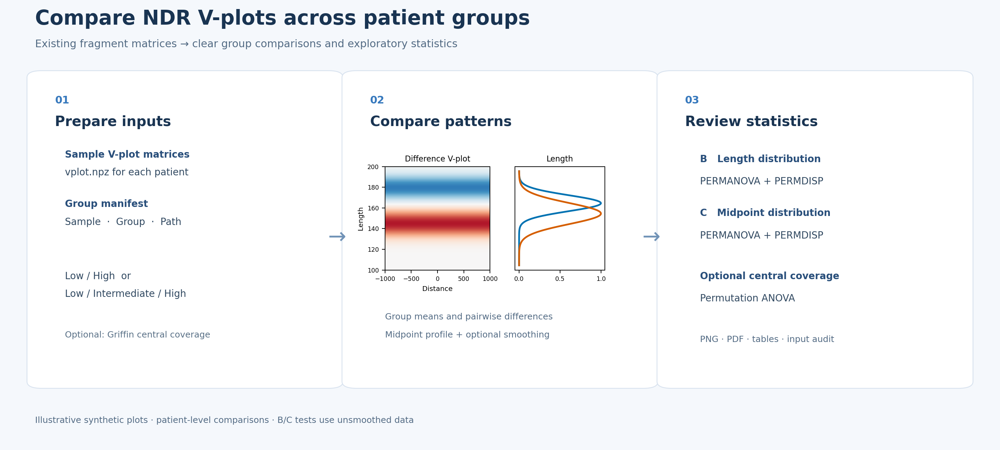

# NDR V-plot Group Figures

A Snakemake workflow to visualize group differences in existing cfDNA NDR V-plot matrices. It produces pairwise difference heatmaps, fragment-length distributions, and midpoint distributions for **two or three independent groups**. No CRAM processing is required.



## Input

Prepare a tab-separated file with `sample`, `group`, and `path`. The path can point to `vplot.npz` or to a sample directory containing it. See [example_groups.tsv](example_groups.tsv). Each sample ID must be unique; groups appear in the order first listed. Use independent patients, matching NDR regions, reference build, sampling conditions, processing and binning. This workflow checks bin edges and available BED hashes, but cannot guarantee all analysis conditions match.

## Run

```bash
python3 -m pip install -r requirements.txt
cp config.example.yaml config.yaml
# Edit manifest and output_dir in config.yaml
snakemake --snakefile Snakefile --configfile config.yaml --cores 1 --dry-run
snakemake --snakefile Snakefile --configfile config.yaml --cores 1
```

Set `channel` to the desired NPZ channel and `sigma_bp` to the midpoint Gaussian smoothing width; default 20 bp, or 0 to disable smoothing. Some Snakemake versions support `--runtime-source-cache-path /path/to/cache`; omit it if unsupported.

## Interpretation

- **A: Pairwise V-plot differences.** Each sample is min–max normalized over all matrix pixels and channels, then averaged with equal patient weight within its group. Pairwise differences use a common zero-centered red/blue scale. Red indicates higher values in the first-named group.
- **B: Fragment-length distribution.** Raw counts are normalized to the selected channel's total per sample, summed across positions and averaged by group. Shaded fill is the area under each curve, not a confidence interval.
- **C: Fragment-midpoint distribution.** The same normalized raw counts are summed across fragment lengths, averaged by group and optionally smoothed.

A and B/C use different normalizations. These counts represent fragment–NDR assignments: fragments may contribute to overlapping region windows. The plots are descriptive, not CNN attribution maps; global distribution tests are exploratory.

## Outputs

`Vplot_group_comparison.png`, `Vplot_group_comparison.pdf`, `group_matrices.npz`, `input_audit.tsv`, and `analysis_metadata.json`. Audit files contain input sample identifiers and paths and may be sensitive.

No patient data or NDR BED is included. No software license has been selected; verify ownership and choose a license before public release.

## References

- Henikoff et al., *PNAS* (2011), [10.1073/pnas.1110731108](https://doi.org/10.1073/pnas.1110731108).
- Bae et al., *Nature Communications* (2023), [10.1038/s41467-023-37768-3](https://doi.org/10.1038/s41467-023-37768-3). This workflow is an independent visualization and is not the authors' CNN or an exact reproduction of their preprocessing.

## Distribution statistics / 분포 검정

R and the R packages `vegan` and `permute` are required (`install.packages(c("vegan", "permute"))`). B (length) and C (midpoint) use each independent patient’s unsmoothed raw-count proportions and Euclidean-distance PERMANOVA; group dispersion is assessed using bias-adjusted spatial-median PERMDISP. Random patient-label permutations are controlled by `permutations` and `seed`. BH q-values cover exactly the two B and C PERMANOVA tests, not other analyses. Equal dispersion is not proven by a non-significant PERMDISP test. V-plot groups defined by fragment-derived TF are not independent TF validation.

Optional `central_coverage` manifest column: provide each matched patient's verified Griffin central −30 to +30 bp average (inclusive), using the same region set and coverage method. If provided for all rows, the workflow performs an independent-patient label permutation ANOVA and displays the global P value. If absent, the central test is not run. Values are supplied by the user, not computed or independently verified by this workflow; use the separate Griffin pipeline to calculate and audit them. Longitudinal paired samples require a different workflow. Outputs include `distribution_tests.tsv`, `central_coverage_test.tsv` when provided, patient profiles, and `R_sessionInfo.txt`.
